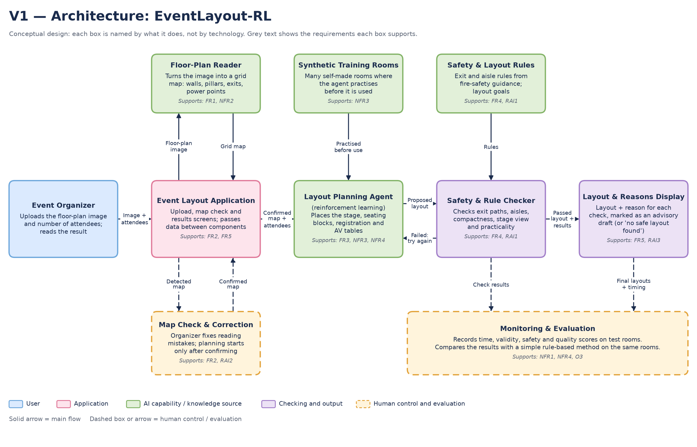

# V1 Architecture — EventLayout-RL

**How it works, in plain words**

1. The organizer uploads a floor-plan image and the number of attendees.
2. The **Floor-Plan Reader** turns the image into a grid map (walls, pillars, exits, power points).
3. The organizer **checks and corrects** the map. Planning cannot start until the map is confirmed.
4. The **Layout Planning Agent** proposes a layout. The **Safety & Rule Checker** checks it; if it fails, the agent tries again.
5. The **Layout & Reasons Display** shows the passed layout with a reason for each check. If no safe layout is found, it says so.

The agent learned beforehand by practising on many **synthetic training rooms**. **Monitoring & Evaluation** records the results on test rooms and compares them with a simple rule-based method.

## Architecture Needs (from the requirements)

The simplest design is *Organizer → Application → Layout Planning Agent → Layout*. On its own, this cannot read images, catch reading mistakes, guarantee safety or explain results, so components were added only where a requirement needs them.

| Requirement ID | What does the requirement need? | Architecture Response |
|---|---|---|
| FR1 / NFR2 | The image must become a map the system can work with. | Floor-Plan Reader |
| FR2 / RAI2 | A person must check the map before planning starts. | Map Check & Correction step (human control) |
| FR3 / NFR3 / NFR4 | Items must be placed well in rooms the system has never seen. | Layout Planning Agent that practised on synthetic training rooms |
| FR4 / RAI1 | An unsafe layout must never be shown as usable. | Separate Safety & Rule Checker using the safety rules, with a "fail → try again" loop |
| FR5 / RAI3 | Reasons must match the real check results. | Layout & Reasons Display, built from the checker's results |
| NFR1 / NFR4 | Time and quality must be measured and compared with a simpler method. | Monitoring & Evaluation, including the rule-based method |

# Architecture Decision Record — EventLayout-RL

| Decision | Requirement / Constraint | Alternatives Considered | Selected Option | Trade-off Accepted |
|---|---|---|---|---|
| Use an RL agent to place items | FR3, NFR3, NFR4: good layouts in rooms never seen before | Fixed rule-based placement; searching from scratch for every room; generative image model | RL agent trained on synthetic rooms before use | Training takes effort and the agent may not learn well; the rule-based method is kept as a comparison to show whether RL is worth it |
| Keep the safety checker separate from the agent | FR4, RAI1: 0 unsafe layouts shown | Trust the agent's learned behaviour; use safety only in the training score | Separate Safety & Rule Checker that checks every layout, with a retry loop | Extra time per layout, and some rooms end with "no safe layout found", but no unsafe layout is shown |
| User checks the map before planning | FR2, RAI2: no layout from an unconfirmed map | Fully automatic reading; user draws the whole map by hand | Automatic reading, then user check and correction | One extra step for the user, but reading mistakes are caught before they reach the layout |
| Write reasons from fixed rules | FR5, RAI3: reasons must match the checks 100%; no paid AI services | A language model writes the explanation; no explanation | Reason templates filled from the checker's results | Reasons are short and less natural, but always match the checks and cost nothing |

# Initial Requirements Traceability Matrix — EventLayout-RL

| Objective | Requirement | Evaluation Criterion | Architecture Element | Later Evidence |
|---|---|---|---|---|
| **O1** | **FR1, NFR2:** Convert the floor-plan image into a correct grid map. | **Floor-Plan Reading Accuracy:** ≥ 95% of grid squares correct. | Floor-Plan Reader | **Pending:** Accuracy results on at least 20 test images compared with hand-made answer maps. |
| **O1** | **FR2, RAI2:** The user confirms the map before planning. | **Human check:** 0 layouts generated from an unconfirmed map. | Map Check & Correction step; Application | **Pending:** Results of test sessions, including images with deliberate reading errors. |
| **O2** | **FR3, NFR3:** Produce a complete layout for unseen rooms. | **Layout Validity:** ≥ 90% of unseen test rooms. | Layout Planning Agent; Synthetic Training Rooms | **Pending:** Validity results on at least 50 unseen test rooms. |
| **O2** | **FR4, RAI1:** Never show an unsafe layout as usable. | **Safety Rule Compliance:** 0 unsafe layouts shown. | Safety & Rule Checker; Safety & Layout Rules; retry loop | **Pending:** Results from the separate re-check script and hand inspection of 20 layouts. |
| **O2, O3** | **NFR4:** Layouts are compact, have a clear stage view and are practical. | **Layout Quality:** ≥ 80% constraint satisfaction, and not lower than the rule-based method. | Layout Planning Agent; Safety & Rule Checker; Monitoring & Evaluation | **Pending:** Side-by-side scores for the RL agent and the rule-based method. |
| **O3** | **FR5, RAI3:** Show a correct reason for each check, plus an advisory notice. | **Reason Correctness:** 100% presence; 100% match. | Layout & Reasons Display | **Pending:** Comparison of the shown reasons with the checker's results for all test layouts. |
| **O3** | **NFR1:** Fast enough for interactive planning. | **Generation Time:** p90 < 30 s. | Whole pipeline; Monitoring & Evaluation (timing) | **Pending:** Timing log and calculated p90 on the test rooms. |

## V1 Review

- **Does each component support a requirement?** Yes. Each box in the diagram lists the requirements it supports.
- **Is anything missing?** Real venue floor plans are not used yet; V1 relies on synthetic rooms. This is a known limitation.
- **Any technology chosen too early?** No. Components are named by what they do. Specific tools are chosen in later topics.
- **Is there a simpler design?** A rule-based method alone would be simpler. It is kept as the comparison, and O3 tests whether the RL agent does better.
