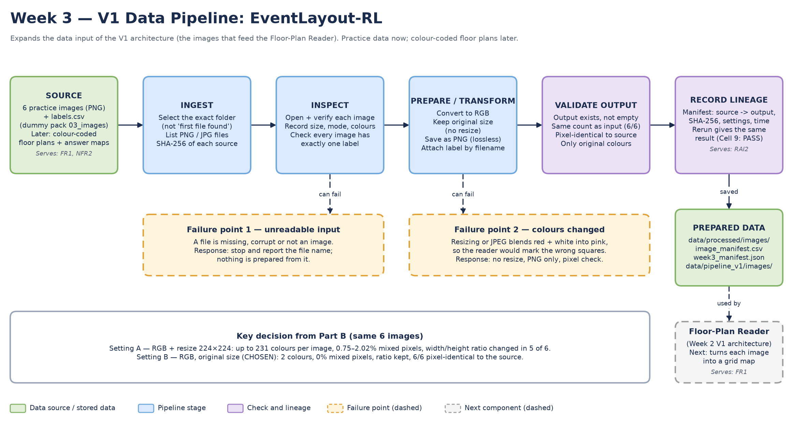

# Pipeline Decisions — EventLayout-RL (Week 3)

> Practice data: Topic 3 Dummy Dataset Pack, `03_images` (synthetic). See the [data inventory](week3_data_inventory.md) and the [notebook](../notebooks/week3_pipeline.ipynb).

|  |  |
|---|---|
| **Topic 2 requirements served** | FR1 and NFR2 (read the image into a correct grid map); RAI2 (traceable input for the user's map check) |
| **Selected source** | S01 `03_images/shape_01–06.png` (6 images) and S02 `labels.csv`: stand-ins for colour-coded floor plans and their answer maps |
| **Pathway** | C — Computer vision (images). Floor plans are images, so no other pathway is needed. |
| **Chosen preparation** | Convert to RGB; **keep the original size** (no resize); save as PNG; carry each image's label into `image_manifest.csv` |
| **Accepted limitation** | Prepared images keep different sizes, so the floor-plan reader must handle any size and use each image's own scale. |
| **ETL or ELT** | **ETL:** images are transformed (to RGB) before the prepared copy is stored, because the reader needs one consistent format. The raw files stay unchanged, so the transformation can be redone at any time. |
| **Batch or streaming** | **Batch:** floor plans arrive a few at a time (one per event, plus a set of training rooms), not as a continuous stream. Each run processes a whole folder. |
| **Output location** | Part B: `data/processed/images/`, `data/processed/image_manifest.csv`, `data/week3_manifest.json` Part C: `data/pipeline_v1/images/` with `pipeline_manifest.json` |
| **Provenance / access caveat** | Synthetic teaching data with no personal data. The manifests record SHA-256 fingerprints, but a fingerprint only proves a file is unchanged, not that it is correct or that we may share it. These results say nothing about EventLayout-RL's real performance. |

## Part B Comparison

| Approach / Configuration A | Approach / Configuration B | Observed Evidence (same 6 images) | Selected Approach and Trade-off |
|---|---|---|---|
| Lab example: convert to RGB **+ resize to 224×224** | Convert to RGB, **keep the original size** | **A:** colours per image rose from 2 to as many as 231; 0.75–2.02% of pixels (mean 1.3%) became mixed colours around the shape edges; the width/height ratio changed in 5 of 6 images. **B:** 2 colours, 0% mixed pixels, ratio kept; all 6 prepared images pixel-identical to their source. | **B.** The floor-plan reader (FR1, NFR2) identifies each square by its exact colour. A mixed edge colour (red + white = pink) matches nothing in the colour code, and squashing the image changes the room's shape. Trade-off: image sizes stay different. |

## Stage Contracts

| Stage | Contract / evidence | Failure response |
|---|---|---|
| Ingest | The selected folder exists and contains images; only `03_images` is chosen, never "the first file found". Evidence: Cell 3 file list. | Stop if the folder or images are missing. |
| Inspect | Every image opens (`verify()`); size and colour mode are recorded; every image has exactly one label. Evidence: Cell A3 and `inspection` in the pipeline manifest. | Stop for an unreadable image; list images without labels. |
| Prepare | Convert to RGB, no resize, save as PNG. Evidence: 6 prepared images with unchanged sizes. | Record the failed file; stop if no image could be prepared. |
| Validate | Outputs exist, are not empty, are pixel-identical to their source, and the output count equals the input count. Evidence: B3 check (6/6). | Stop for a missing, empty or changed output. |
| Record lineage | Every source links to exactly one output, with the SHA-256 of both, the settings and the time. Evidence: Cell 6B PASS; Cell 9 rerun PASS. | Stop if a link, fingerprint or setting is missing or does not match. |

## Two Failure Points (shown on the diagram)

1. **A file is missing, corrupt or not an image**, so it cannot be opened at Inspect. *Response:* stop and report the file name; nothing is prepared from it.
2. **A transformation changes the colours** (resizing or JPEG compression blends red and white into pink), so the reader would mark the wrong squares. *Response:* keep the original size, save only as PNG, and check that each prepared image is identical to its source.

## Traceability

The FR1/NFR2 and FR2/RAI2 rows of the [Week 2 traceability matrix](week2_architecture_decisions.md#initial-requirements-traceability-matrix--eventlayout-rl) now link to this Week 3 evidence.
